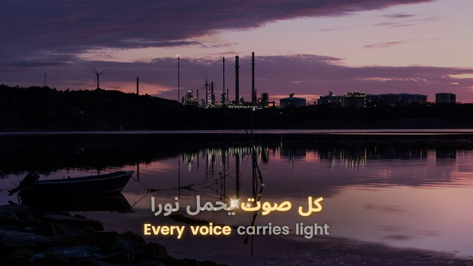
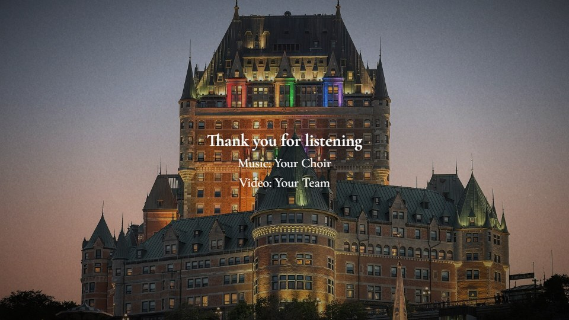
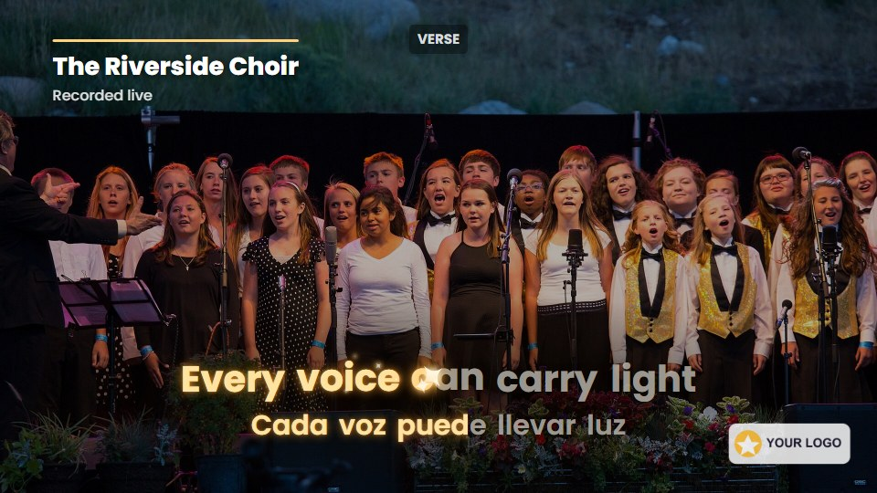
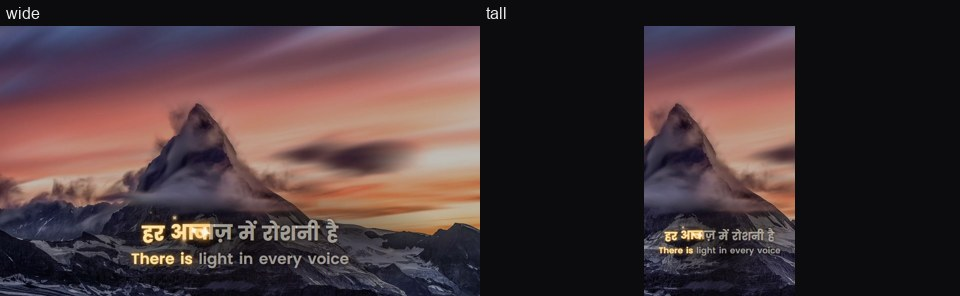

<div align="center">

# motion-lyrics

**Beautiful lyric videos from any video and its lyrics, in any language. Just ask your AI assistant.**

[](https://github.com/rohanvijaykumar/motion-lyrics/actions/workflows/ci.yml)
[](LICENSE)
[](https://www.remotion.dev)


</div>

You do not need to be technical. You give your AI assistant (Claude, Codex, Cursor...) a link
to this page, your video and your lyrics. It sets everything up, times every word to the
singing, checks every line, and hands you a finished video. To change anything, you just tell
it what you want in your own words.

---

## How to start

**1. Open your AI assistant** that can work on your computer, for example
[Claude Code](https://claude.com/claude-code) (the desktop app or terminal), Codex, or Cursor.

**2. Paste this message**, with your own file names:

```text
Set up https://github.com/rohanvijaykumar/motion-lyrics and make a lyric video
from my video "my-song.mp4" with these lyrics:

(paste the lyrics here, or say where the lyrics file is)
```

**3. Answer its three questions.** It asks which **style** you like (the pictures above), where the
lyrics should **sit** (bottom, centre or top), and whether lyrics may **move away from faces**.

That's it. The first time, it downloads what it needs (about 3 GB, once) and installs any
missing programs for you. A three-minute song then takes roughly 30 to 60 minutes on a normal
laptop. It tells you when your video is ready and where to find it.

---

## Then just ask for changes

Talk to your assistant like you would to a video editor. For example:

> *"Make the lyrics bigger."* · *"Use the Montserrat font."* · *"Here is our brand font file, use it."*
> *"Make the sung words gold."* · *"Put the lyrics at the top."* · *"Try the neon style."*
> *"Add the song title at the start."* · *"Add our logo in the corner."* · *"Show the singer's name."*
> *"Add the English translation under each line."* · *"Make a vertical version for Instagram Reels."*
> *"Make a 4K version."* · *"The second line comes in a little late."* · *"Perfect, I'm done."*

When you say you are done, it keeps your final video and tidies up the working files it no
longer needs.

---

## What it can do

### Lyrics that light up as they are sung

Every word is timed to the singer and lights up as it is sung, in nine styles (gallery at the
top) or your own fonts and colours.

### Translations under the lyrics

Show a translation (or the pronunciation) under each sung line. It lights up along with the
line. Right-to-left languages like Arabic and Hebrew read and highlight right to left.



### Title cards and end credits

Open with the song title and artist; close with credits.

| Title card | Credits |
| --- | --- |
|  |  |

### Names, logos and section labels

A name card for the singer or choir, your logo in a corner, and labels such as *Verse* or
*Chorus* as each part begins. Name cards automatically stay clear of the lyrics.



### Subtitles and social-media captions

Prefer something quieter? Use simple subtitles. Making a Reel, Short or TikTok? Big captions a
few words at a time, with the sung word boxed.

| Subtitles | Vertical captions |
| --- | --- |
|  |  |

### Wide and vertical, 1080p and 4K

One project gives you every size: wide 16:9 for YouTube and vertical 9:16 for phones, in
1080p or 4K. For vertical versions the picture follows the people in the shot, and the lyrics
are laid out fresh for the tall frame.



### Any language

Hindi, Arabic, Japanese, Chinese, Korean, Tamil, Thai, Spanish, French, Russian, Hebrew and
many more, with the right fonts chosen automatically. Timing works in over 1,100 languages.

### It checks its own work

- **Timing.** It double-checks the timing of every line with a second listening model and tells you
  (and your assistant) which lines, if any, deserve a second look.
- **Every line on screen.** Before each video is made, it looks at every lyric line: is it on
  screen, not cut off, readable against the picture, big enough, and in the right font? It fixes
  problems itself (without moving your lyrics) and checks again.
- **The final file.** It confirms the finished video matches what was checked.

---

## Styles

| Style | Looks like | Good for |
| --- | --- | --- |
| **golden-sparkle** (default) | Warm gold fill, a spinning star and sparkles on each sung word | Lyric videos, celebrations |
| **chalk** | Hand-written chalk lettering | Classrooms, children's songs |
| **classic-karaoke** | Two rows; the current line fills blue | Sing-alongs |
| **social-pop** | Big words a few at a time, yellow box on the sung word | Reels, Shorts, TikTok |
| **kinetic** | Huge type; each word lands as it is sung | High-energy songs |
| **scroll-focus** | The whole lyric sheet scrolls; the sung line glows | Music-player look |
| **minimal-subtitles** | Quiet subtitles on a soft dark band | Talks, documentaries |
| **cinematic** | Elegant serif lettering with a soft glow | Ballads, film |
| **neon** | Words switch on with a neon glow | Night, dance, electronic |

You can also ask for your own style ("our brand colours and font") and reuse it for every video.

---

## Questions

<details>
<summary><b>Which AI assistants work?</b></summary>

Any assistant that can run commands on your computer: Claude Code (desktop app or terminal),
OpenAI Codex, Cursor, Gemini CLI and similar. Chat-only assistants in a browser cannot install
software, so they cannot do this.
</details>

<details>
<summary><b>Does it cost anything?</b></summary>

motion-lyrics is free. Everything runs on your own computer. You only need your AI assistant's
own plan. Large companies (more than 3 people, for-profit) need a
[Remotion license](https://www.remotion.dev/license) to make videos; individuals, non-profits
and small teams do not.
</details>

<details>
<summary><b>What gets downloaded, and how much space does it need?</b></summary>

About 3 GB once: the model that times each word (1.2 GB), the speech-recognition model that
double-checks it (about 1.5 GB), a model that separates the singer from the music (80 MB), and
the browser that draws the frames (130 MB). Each video project needs some extra space while
it is being made; approving a video frees most of it.
</details>

<details>
<summary><b>Is my video uploaded anywhere?</b></summary>

No. Your video, lyrics and finished files stay on your computer. Fonts are fetched from Google
Fonts while drawing, and models are downloaded once during setup.
</details>

<details>
<summary><b>What if a lyric is slightly early or late?</b></summary>

Tell your assistant, for example "the line 'every step is new' starts too early". It looks at
a picture of the singing to find the exact moment, fixes it and makes the video again.
</details>

<details>
<summary><b>I want to do it myself, without an assistant</b></summary>

Everything works by hand too. Start with [docs/cli.md](docs/cli.md) (setup and every command),
then [docs/lyrics-format.md](docs/lyrics-format.md), [docs/styles.md](docs/styles.md) and
[docs/graphics.md](docs/graphics.md).
</details>

---

## For developers

- [AGENTS.md](AGENTS.md): the step-by-step playbook assistants follow (setup from scratch, checks, approval)
- [docs/cli.md](docs/cli.md): commands · [docs/pipeline.md](docs/pipeline.md): how it works and accuracy numbers
- [docs/styles.md](docs/styles.md) · [docs/graphics.md](docs/graphics.md) · [docs/languages.md](docs/languages.md) · [docs/lyrics-format.md](docs/lyrics-format.md)
- [CONTRIBUTING.md](CONTRIBUTING.md)

Built with [Remotion](https://www.remotion.dev), Demucs, Meta's MMS aligner and Whisper.

## License

The code is MIT. It runs software with its own terms: **Remotion is free for individuals,
non-profits and companies of up to 3 people; larger companies need a
[Remotion license](https://www.remotion.dev/license)**, and **the MMS timing model is
CC BY-NC 4.0 (non-commercial)**. Background photos in the examples are public domain or CC0
([credits](examples/photos/CREDITS.md)). Details: [THIRD_PARTY.md](THIRD_PARTY.md).

This project uses the universal romanizer software 'uroman' written by Ulf Hermjakob, USC
Information Sciences Institute (2015-2020).
