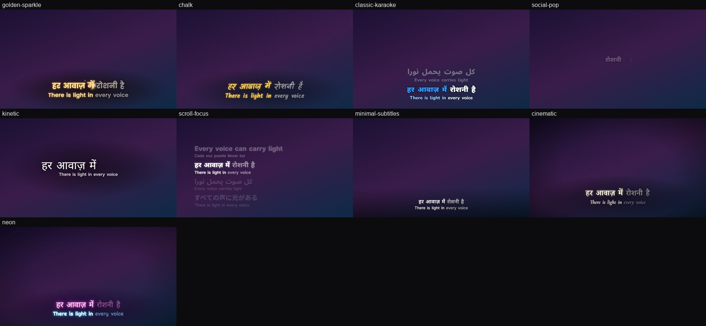
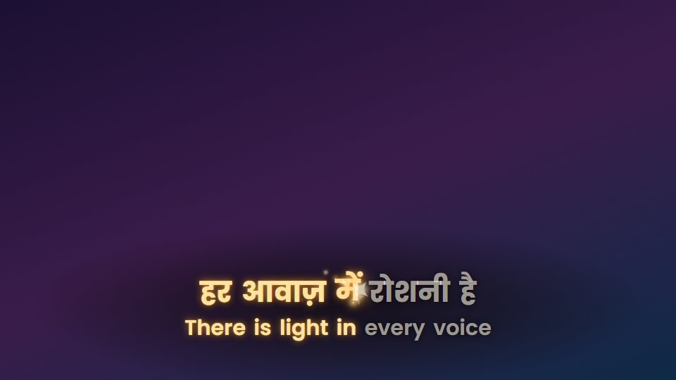
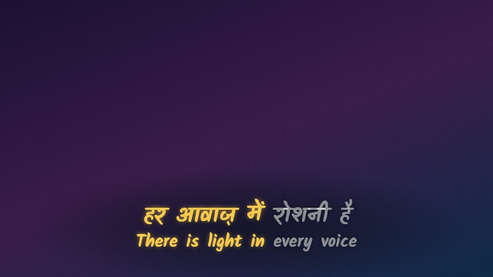
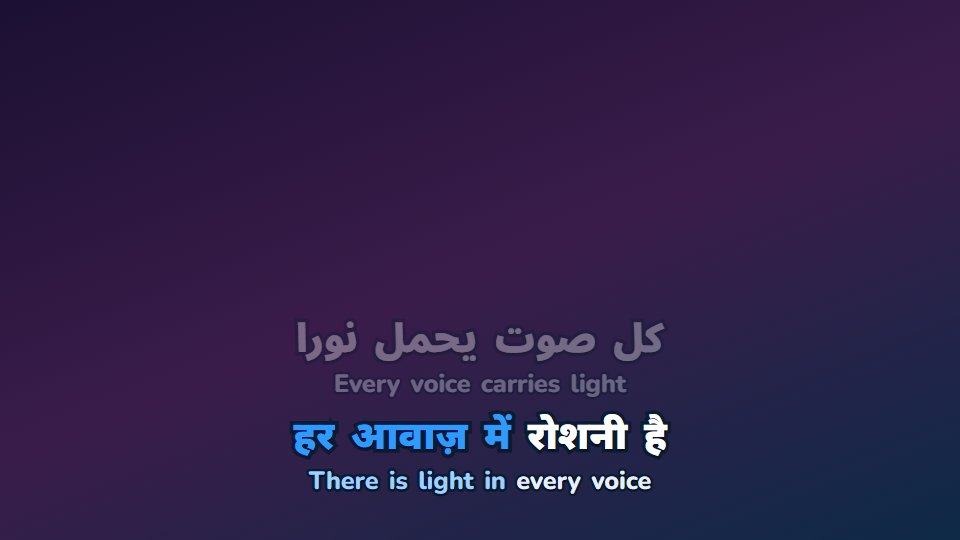
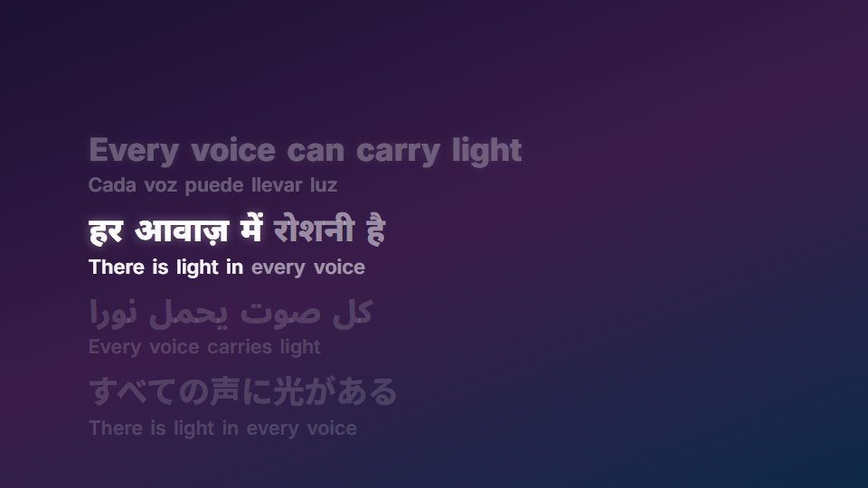
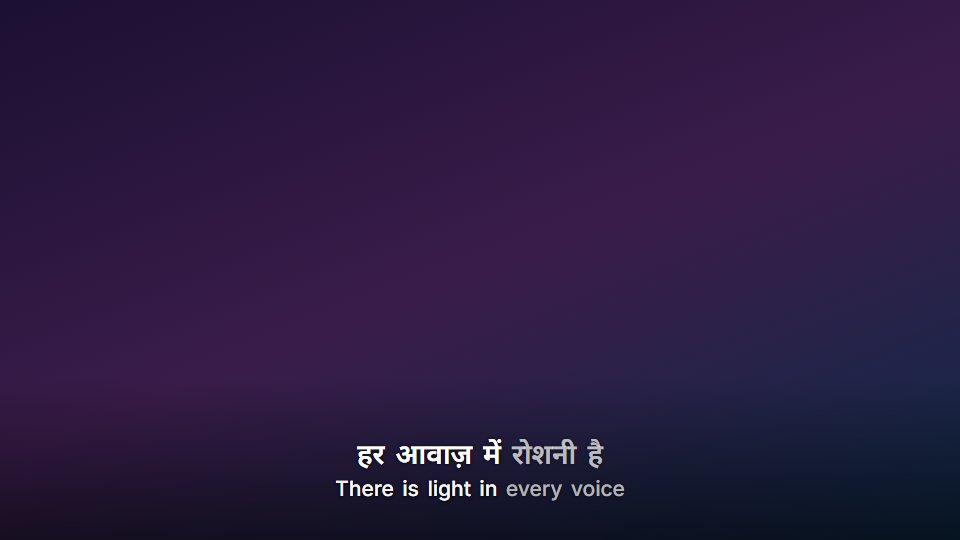
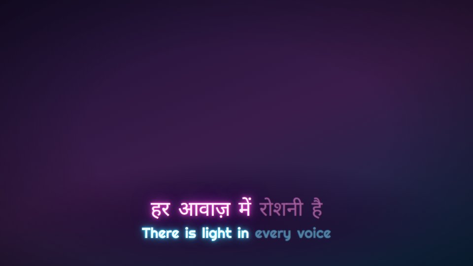

<div align="center">

# motion-lyrics

**Turn any video and its lyrics into a beautiful lyric video, in any language, with one command.**

[](https://github.com/rohanvijaykumar/motion-lyrics/actions/workflows/ci.yml)
[](LICENSE)
[](https://www.remotion.dev)
[](https://nodejs.org)



</div>

You give it a video (or a song) and a text file with the lyrics. It finds the singer's voice,
works out exactly when every word is sung, highlights each word as it is sung, checks every
line on screen, and renders a finished video in 1080p or 4K, wide or vertical.

- **Any language, any script.** Hindi, Arabic, Japanese, Tamil, Thai, Spanish, Chinese, Korean,
  Hebrew... with translations shown under the sung line.
- **Nine ready-made styles**, plus your own fonts, colours and presets.
- **Checks its own work.** It flags lines whose timing might be off and checks every lyric frame
  for position, size, contrast and font problems, fixing what it can by itself.
- **Wide and vertical, 1080p and 4K** from the same project.
- **Tidy.** When you approve a video it clears out the bulky working files.

---

## Contents

1. [Before you start (one time)](#1-before-you-start-one-time)
2. [Make your first video](#2-make-your-first-video)
3. [Pick a style](#3-pick-a-style)
4. [Make it yours: fonts, colours, position, logo](#4-make-it-yours)
5. [Export sizes](#5-export-sizes)
6. [Checks, approval and cleanup](#6-checks-approval-and-cleanup)
7. [Languages](#7-languages)
8. [Using it with an AI agent](#8-using-it-with-an-ai-agent)
9. [Questions and problems](#9-questions-and-problems)
10. [All commands](#10-all-commands)

---

## 1. Before you start (one time)

You need three free programs. If you already have them, skip to the four commands below.

| Program | What it is for | Get it |
| --- | --- | --- |
| **Node.js** 20 or newer | runs motion-lyrics | [nodejs.org](https://nodejs.org) - pick the "LTS" download |
| **Git** | downloads this project | [git-scm.com](https://git-scm.com/downloads) |
| **uv** | installs the audio tools (it installs Python for you) | one command, below |

Install **uv** by opening a terminal (Windows: *PowerShell*; Mac: *Terminal*) and pasting:

<details open>
<summary><b>Windows</b></summary>

```powershell
powershell -ExecutionPolicy ByPass -c "irm https://astral.sh/uv/install.ps1 | iex"
```
</details>

<details>
<summary><b>Mac or Linux</b></summary>

```bash
curl -LsSf https://astral.sh/uv/install.sh | sh
```
</details>

Close the terminal and open a new one, then run these four lines:

```bash
git clone https://github.com/rohanvijaykumar/motion-lyrics.git
cd motion-lyrics
npm install
npm run setup
```

`npm run setup` downloads about 3 GB once (the speech and music models) and takes a few
minutes. When it says **Setup complete**, check everything with:

```bash
npm run doctor
```

> **Tip:** want to see it working right away? Run `npm run studio` to open the demo in your
> browser.

---

## 2. Make your first video

### Step 1: write the lyrics

Make a text file, for example `lyrics.txt`. One sung line per line, and an empty line between
screens:

```text
@lang: hi, en

हर आवाज़ में रोशनी है
Light in every voice

Every step is new
> Cada paso es nuevo
```

- `@lang:` lists the languages in the song (`hi` Hindi, `en` English, `es` Spanish, `ar` Arabic, `ja` Japanese...).
- A line starting with `>` is a **translation**: shown under the line above, not sung.
- Write every line in the order it is sung, including repeated choruses.

More options: [docs/lyrics-format.md](docs/lyrics-format.md).

### Step 2: run one command

```bash
npm run make -- my-song --video "path/to/video.mp4" --lyrics "path/to/lyrics.txt"
```

It first asks you three things:

1. **Which style** (see the gallery below).
2. **Where the lyrics sit**: bottom, center or top. They stay in that place for the whole video.
3. **Face avoidance**: whether lyrics may move away from faces. It stays off unless you turn it on.

Then it works on its own: it isolates the singer, times every word, checks every line, and
renders. On a typical laptop expect about 30 to 60 minutes for a three-minute song, most of it
rendering. You can leave it running.

### Step 3: watch, then approve

Your video is in `projects/my-song/out/`. Watch it once with sound. If a line needs a nudge,
the report in `projects/my-song/review/report.md` shows which lines to look at and how to fix
them. When you are happy:

```bash
npm run approve -- my-song
```

This keeps your video and deletes the large working files (see [cleanup](#6-checks-approval-and-cleanup)).

---

## 3. Pick a style

Choose a style when `make` asks, or with `--preset <name>`. List them anytime with `npm run presets`.

<table>
<tr>
<td width="33%"><br><b>golden-sparkle</b> (default)<br>Warm gold fill with a spinning star at the edge of the highlight and sparkles shed from each sung word. Lyric videos, celebrations.</td>
<td width="33%"><br><b>chalk</b><br>Hand-written lettering with a warm yellow fill and soft film grain. Classrooms, children's songs.</td>
<td width="33%"><br><b>classic-karaoke</b><br>Two rows like a karaoke machine; the next line waits while the current one fills blue. Sing-alongs.</td>
</tr>
<tr>
<td><br><b>social-pop</b><br>Two or three big words at a time with a yellow box on the sung word. Reels, Shorts, TikTok.</td>
<td><br><b>kinetic</b><br>Huge type; each word lands the moment it is sung, pulsing on the beat. High-energy tracks.</td>
<td><br><b>scroll-focus</b><br>The whole lyric sheet scrolls; the sung line is bright and the rest fades back. Music-player look.</td>
</tr>
<tr>
<td><br><b>minimal-subtitles</b><br>Quiet subtitles on a thin dark band. Talks, documentaries, accessibility.</td>
<td><br><b>cinematic</b><br>Elegant serif lettering that blooms in, with a vignette, grain and drifting light. Ballads, film.</td>
<td><br><b>neon</b><br>Words switch on with a pink neon glow. Night, dance, electronic.</td>
</tr>
</table>

Every style works in every language and in wide and vertical video. Everything you can change:
[docs/styles.md](docs/styles.md).

---

## 4. Make it yours

All of these are optional.

| I want to... | Do this |
| --- | --- |
| Use a **Google Font** | `--font "Montserrat"` (any name from [fonts.google.com](https://fonts.google.com)) |
| Use **my own font file** | `--font "C:/Fonts/MyBrand-Bold.ttf"`, or drop `.ttf`/`.otf`/`.woff2` files into `projects/my-song/fonts/` and use the name before the dash (`MyBrand`) |
| Change the **highlight colour** | `--color "#2ec4b6"` |
| Put lyrics at the **top** or **centre** | `--position top` or `--position center` |
| Let lyrics **avoid faces** | `--avoid-faces on` (lyrics may then change position when a face is in the way) |
| Add a **title card or logo** | add a `graphics` entry in `projects/my-song/project.json` ([docs/graphics.md](docs/graphics.md)) |
| Save **my own style** to reuse | add a JSON file in `presets/` ([presets/README.md](presets/README.md)), then `--preset my-style` |
| Set **my defaults** for every video | copy `motion-lyrics.config.example.json` to `motion-lyrics.config.json` and edit it |
| Change anything else | edit `projects/my-song/project.json` (your editor autocompletes every option), then `npm run render -- my-song` |

Preview your changes live: `npm run studio -- my-song` opens the video in your browser; refresh
after saving.

---

## 5. Export sizes

| Size | Wide 16:9 | Vertical 9:16 |
| --- | --- | --- |
| **1080p** | 1920 x 1080 | 1080 x 1920 |
| **4K** | 3840 x 2160 | 2160 x 3840 |

```bash
npm run render -- my-song --size 4k --aspect 9:16    # one format
npm run render -- my-song --all                      # all four
```

Lyrics are laid out fresh for each shape, never squashed. Text is drawn at full resolution, so
4K lyrics are sharp even from 1080p footage (the footage itself is upscaled). For a vertical
video from wide footage, the picture is cropped and follows the faces. Prefer no crop? Set
`"background": { "fit": "blur" }` in project.json to show the whole picture over a blurred copy.

---

## 6. Checks, approval and cleanup

**Timing review.** After timing every word, it marks lines to **check** (timing probably off)
and lines to **glance at**, each with a picture of the singing so you can see why. On
hand-timed test songs, 98% of badly timed words land in a flagged line. Report:
`review/report.md`.

**Visual QC (automatic).** Before every render it looks at a frame of **every lyric line** in
every export size and checks that the line:

- is on screen and inside the safe area, not cut off at an edge,
- does not overlap the line next to it,
- stands out from the picture behind it,
- is big enough to read,
- uses the intended font for every character (no empty boxes).

When something fails it fixes it without moving your lyrics: it shrinks text to fit, adds dark
backing or an outline, or widens the margins for the whole video. Then it re-renders that frame
and checks again (up to three rounds). After the render it confirms the finished video matches
what was checked. Report: `review/qc/<size>/report.md`. Run it alone with `npm run qc -- my-song`.

**Approve and clean up.** `npm run approve -- my-song` records the approved video, then lists
the files it will remove, with sizes, and asks before deleting anything:

| Removed | Kept |
| --- | --- |
| extracted audio, isolated vocals, speech caches | `project.json`, `lyrics.txt`, `song.json`, `analysis.json`, `fonts/` |
| drafts and renders you did not approve | your approved videos |
| QC and review frame images, render bundles | timing and QC reports, the contact sheet |
| the copy of your source video (only with `--media`) | the source video copy (by default) |

---

## 7. Languages

Word splitting, fonts and right-to-left text work for every script, and timing works in
1,100+ languages. Two languages sharing an alphabet (English and Spanish, say) need a tag on
lines in the second one: `{es} Hola mundo`. Details: [docs/languages.md](docs/languages.md).

---

## 8. Using it with an AI agent

Open the folder in [Claude Code](https://claude.com/claude-code) (or another coding agent) and
ask, for example:

> Make a lyric video from `~/Videos/song.mp4` with the lyrics in `~/Videos/lyrics.txt`.

The agent follows [AGENTS.md](AGENTS.md): it asks you the three style questions first, then
makes, checks and renders the video, and shows you the timing and QC reports. Claude Code also
loads the `/motion-lyrics` skill from `.claude/skills/`.

---

## 9. Questions and problems

<details>
<summary><b>"uv is not installed" or "npm is not recognized"</b></summary>

Install the program from [section 1](#1-before-you-start-one-time), then **close and reopen
the terminal** so it is found. Run `npm run doctor` to check.
</details>

<details>
<summary><b>It is slow</b></summary>

Everything runs on your computer's processor, and the first run also downloads models.
Speed-ups: `--fast` skips the speech-recognition cross-check (less safe), `--draft` makes a
quick half-size preview, `--no-render` stops before rendering.
</details>

<details>
<summary><b>A line's timing is a little off</b></summary>

`npm run shift -- my-song --line g3l1 --by 0.2` moves that line 0.2 s later (negative =
earlier). Line ids are in the review report. Then `npm run render -- my-song`.
</details>

<details>
<summary><b>The lyrics text is wrong</b></summary>

Edit `projects/my-song/lyrics.txt` and run `npm run make -- my-song` again. Finished steps are
reused, so it is quicker the second time.
</details>

<details>
<summary><b>Rendering says "Font loading failed"</b></summary>

Google Fonts are downloaded while rendering, so you need an internet connection. Your own font
files in `fonts/` work offline.
</details>

<details>
<summary><b>What is "Studio"?</b></summary>

Remotion Studio is a preview app that opens in your web browser on your own computer
(`npm run studio -- my-song`). You can play the video, scrub through it and see your edits.
It is optional.
</details>

<details>
<summary><b>What are the 3 GB of downloads?</b></summary>

The word-timing model (MMS, 1.2 GB), Whisper speech recognition (about 1.5 GB), the singer
separation model (Demucs, 80 MB), the browser that draws frames (130 MB) and a tiny face
detector. They are downloaded once and reused.
</details>

---

## 10. All commands

| Command | What it does |
| --- | --- |
| `npm run make -- <name> --video <file> --lyrics <file>` | everything: asks your choices, times, checks, renders |
| `npm run make -- <name>` | run an existing project again (finished steps are reused) |
| `npm run render -- <name> [--size 1080\|4k] [--aspect 16:9\|9:16] [--all]` | render (with QC) |
| `npm run render -- <name> --draft` | quick half-size preview with a timing overlay |
| `npm run qc -- <name> [--all]` | visual QC only |
| `npm run approve -- <name> [--yes] [--media]` | approve the video and clean up |
| `npm run studio -- <name>` | live preview in the browser |
| `npm run shift -- <name> --line <id> --by <seconds>` | nudge timing (also `--word`, `--from`/`--to`) |
| `npm run still -- <name> --time 12.5` | save one frame as an image |
| `npm run align -- <name>` / `review` / `validate` | re-time, rebuild the review, check files |
| `npm run presets` / `doctor` / `setup` / `bench` | list styles, check setup, install, accuracy test |

Options for `make`: `--preset`, `--position`, `--avoid-faces on|off`, `--font`, `--color`,
`--size`, `--aspect`, `--all`, `--audio song.mp3` (no video: animated background),
`--lang hi,en`, `--draft`, `--no-render`, `--fast`, `--force`, `--yes` (do not ask questions).

---

## How it works

Demucs isolates the singer; Meta's MMS model, guided by Whisper, times every word; the lyrics
are drawn by React components in [Remotion](https://www.remotion.dev) and encoded with FFmpeg.
Accuracy numbers and the full pipeline: [docs/pipeline.md](docs/pipeline.md). Contributing:
[CONTRIBUTING.md](CONTRIBUTING.md).

## License

The code is MIT. It runs software with its own terms: **Remotion is free for individuals,
non-profits and companies of up to 3 people; larger companies need a
[Remotion license](https://www.remotion.dev/license)**, and **the MMS timing model is
CC BY-NC 4.0 (non-commercial)**. Details and credits: [THIRD_PARTY.md](THIRD_PARTY.md).

This project uses the universal romanizer software 'uroman' written by Ulf Hermjakob, USC
Information Sciences Institute (2015-2020).
