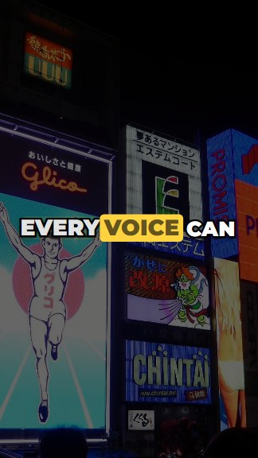

<div align="center">

# motion-lyrics

**Word-synced, multilingual lyric videos from any video and its lyrics, driven by your AI coding agent and rendered with Remotion.**

[](https://github.com/rohanvijaykumar/motion-lyrics/actions/workflows/ci.yml)
[](LICENSE)
[](https://www.remotion.dev)


</div>

motion-lyrics isolates the vocal, aligns every lyric word to the singing, checks every frame,
and renders finished video in 1080p or 4K, wide or vertical. It is designed to be operated by
an AI coding agent such as Claude Code, Codex or Cursor: point the agent at this repository,
describe the video you want, and it handles installation, rendering, quality checks and
revisions. Every step can also be run directly from the command line.

---

## Quick start

**1. Open an AI coding agent** that can run commands on your machine:
[Claude Code](https://claude.com/claude-code) (desktop app or CLI), Codex, Cursor or similar.

**2. Give it the repository and your material:**

```text
Set up https://github.com/rohanvijaykumar/motion-lyrics and make a lyric video
from my video "my-song.mp4" with these lyrics:

(paste the lyrics here, or say where the lyrics file is)
```

**3. Answer three questions:** the **style** (gallery above), the lyric **position** (bottom,
centre or top, fixed for the whole video), and whether lyrics may **move away from faces**.

The agent follows [AGENTS.md](AGENTS.md): it installs missing prerequisites (Node.js, uv,
Python), downloads the models once (about 3 GB), runs the pipeline, reviews the timing and QC
reports, and tells you where the finished file is. A three-minute song takes roughly 30 to 60
minutes on a typical laptop CPU, most of it rendering.

---

## Installation

Pick whichever suits you. All of them end in the same place: a working install that
`npm run doctor` confirms as **Everything is ready**.

### Option 1: let your agent install it (recommended)

Give the agent the repository link, as in the quick start above. It clones the repository,
installs any missing prerequisites and runs the setup. No further steps.

### Option 2: one-step setup script

Clone or [download the ZIP](https://github.com/rohanvijaykumar/motion-lyrics/archive/refs/heads/main.zip)
(unzip it), open a terminal in the folder, and run the script for your system. It installs
anything missing (Node.js; Git on Windows; uv and Python), then the packages, the models
(about 3 GB, once) and the render browser.

<details open>
<summary><b>Windows (PowerShell)</b></summary>

```powershell
git clone https://github.com/rohanvijaykumar/motion-lyrics.git
cd motion-lyrics
powershell -ExecutionPolicy Bypass -File setup.ps1
```

Or right-click `setup.ps1` and choose **Run with PowerShell**.
</details>

<details>
<summary><b>macOS / Linux</b></summary>

```bash
git clone https://github.com/rohanvijaykumar/motion-lyrics.git
cd motion-lyrics
sh setup.sh
```

On macOS without Homebrew or Node.js, install Node.js from [nodejs.org](https://nodejs.org)
first; on Linux the script uses NodeSource and `apt`.
</details>

### Option 3: manual install

1. Install the prerequisites:
   - [Node.js](https://nodejs.org) 20 or newer
   - [Git](https://git-scm.com/downloads) (or use the ZIP download above)
   - [uv](https://docs.astral.sh/uv/getting-started/installation/), which installs the right
     Python for you. `npm run setup` installs uv automatically if it is missing.
2. Then:

   ```bash
   git clone https://github.com/rohanvijaykumar/motion-lyrics.git
   cd motion-lyrics
   npm install
   npm run setup      # Python pipeline, models (about 3 GB), render browser
   npm run doctor     # checks everything, including each model
   ```

### Option 4: try the preview only

`npm install` followed by `npm run studio` opens the bundled demo in Remotion Studio without
the audio models. That is enough to explore the styles and graphics; making videos from your own
footage needs the full setup.

### Updating

```bash
git pull
npm install
npm run setup      # quick when nothing changed; fetches any new models
```

### Requirements

Windows 10/11, macOS or Linux; about 6 GB of free disk space for the install plus room for
your projects; an internet connection for the first setup and for Google Fonts while
rendering. A GPU is optional; everything runs on the CPU.

---

## Iterate in plain language

Revisions are requests to the agent, the same way you would brief an editor:

> *"Make the lyrics bigger."* · *"Use the Montserrat font."* · *"Here is our brand font file, use it."*
> *"Make the sung words gold."* · *"Put the lyrics at the top."* · *"Try the neon style."*
> *"Add the song title at the start."* · *"Add our logo in the corner."* · *"Show the singer's name."*
> *"Add the English translation under each line."* · *"Make a vertical version for Instagram Reels."*
> *"Make a 4K version."* · *"The second line comes in a little late."* · *"Perfect, I'm done."*

Each change is validated, re-checked by QC and re-rendered. When you approve the result, the
agent records the approval and removes intermediate files, keeping the final video and reports.

---

## Capabilities

### Word-level karaoke highlighting

Every word is aligned to the isolated vocal and highlighted as it is sung: a wipe, a colour
change or a boxed word, with optional glints, sparkles, beat pulses and entrance and exit
animations. Nine presets ship with the project (gallery above); fonts, colours, sizes and
effects are all configurable, and custom presets can be saved and reused.

### Translations and romanization

A translation or pronunciation line can sit under each sung line and fills in step with it.
Right-to-left scripts (Arabic, Hebrew) are laid out and highlighted right to left; joined and
stacked scripts (Arabic, Devanagari, Tamil) keep correct shaping.


### Title cards and end credits

Opening titles with artist, and closing credits. The final lyric screen clears before the
credits begin.

| Title card | Credits |
| --- | --- |
|  |  |

### Lower thirds, logos and section labels

Name cards for performers, a logo or watermark, and *Verse* / *Chorus* labels at section
starts. Lower thirds reposition automatically so they never collide with the lyrics. Lottie
animations and free text are also supported ([graphics reference](docs/graphics.md)).


### Subtitles and short-form captions

From understated subtitles on a soft band to short-form captions a few words at a time with
the sung word boxed, sized for vertical video.

| Subtitles | Vertical captions |
| --- | --- |
|  |  |

### 1080p and 4K, 16:9 and 9:16

Any project renders to wide and vertical at 1080p or 4K. The layout is recomputed for each
frame shape; text is drawn at native resolution; vertical crops follow the faces in shot, or
the full picture can sit over a blurred fill.


### Multilingual by design

Word segmentation (including Chinese, Japanese and Thai, which use no spaces), per-script font
selection with Noto fallbacks, and forced alignment covering more than 1,100 languages through
romanization. See [docs/languages.md](docs/languages.md).

### Quality control

- **Timing review.** A second recognition model cross-checks the alignment; lines likely to be
  off are flagged with spectrogram strips. On a hand-timed benchmark, 98% of mistimed words fall
  in a flagged line ([accuracy](docs/pipeline.md#accuracy)).
- **Visual QC.** Before each render, a frame of every lyric line is checked in every export
  format for safe-area violations, clipping, collisions, contrast, size and missing glyphs.
  Failures are fixed without moving the lyrics and re-checked.
- **Output verification.** Frames from the finished file are compared with the frames QC
  approved.

---

## Styles

| Style | Looks like | Good for |
| --- | --- | --- |
| **golden-sparkle** (default) | Warm gold fill, a spinning star and sparkles on each sung word | Lyric videos, celebrations |
| **chalk** | Hand-written chalk lettering | Classrooms, children's songs |
| **classic-karaoke** | Two rows; the current line fills blue | Sing-alongs |
| **social-pop** | Big words a few at a time, yellow box on the sung word | Reels, Shorts, TikTok |
| **kinetic** | Huge type; each word lands as it is sung | High-energy songs |
| **scroll-focus** | The whole lyric sheet scrolls; the sung line glows | Music-player look |
| **minimal-subtitles** | Quiet subtitles on a soft dark band | Talks, documentaries |
| **cinematic** | Elegant serif lettering with a soft glow | Ballads, film |
| **neon** | Words switch on with a neon glow | Night, dance, electronic |

Custom styles (brand fonts and colours, for example) can be saved as presets and reused across projects.

---

## FAQ

<details>
<summary><b>Which agents are supported?</b></summary>

Any agent that can run shell commands on your machine: Claude Code (desktop app or CLI), OpenAI
Codex, Cursor, Gemini CLI and similar. Browser-only chat assistants cannot install software or
render video. Claude Code also loads the bundled `/motion-lyrics` skill.
</details>

<details>
<summary><b>Licensing and cost</b></summary>

motion-lyrics is MIT licensed and runs locally. Remotion is free for individuals, non-profits
and companies of up to three people; larger for-profit companies need a
[Remotion company license](https://www.remotion.dev/license). The MMS alignment model is
CC BY-NC 4.0 (non-commercial); see [THIRD_PARTY.md](THIRD_PARTY.md).
</details>

<details>
<summary><b>Downloads and disk space</b></summary>

About 3 GB, once: MMS forced aligner (1.2 GB), Whisper `medium` (about 1.5 GB), Demucs vocal
separation (80 MB), the headless Chrome used for rendering (130 MB) and a face detector. Projects
use additional space for intermediate audio and frames; approval removes it. Temporary render
files stay inside the repository's `.cache/tmp` folder and are deleted as soon as each command
finishes, so they never build up on your system drive.
</details>

<details>
<summary><b>Privacy</b></summary>

Nothing is uploaded. Media, lyrics and renders stay on your machine. Network access is used
for the one-time model download and for fetching Google Fonts at render time.
</details>

<details>
<summary><b>Correcting timing</b></summary>

Tell the agent which line is off ("'every step is new' comes in early"). It inspects the
spectrogram strip for that line, adjusts and locks the timing, and re-renders. Locked lines are
preserved if alignment is re-run.
</details>

<details>
<summary><b>Running it without an agent</b></summary>

Every step is a single command: [docs/cli.md](docs/cli.md) covers setup and the full CLI;
[docs/lyrics-format.md](docs/lyrics-format.md), [docs/styles.md](docs/styles.md) and
[docs/graphics.md](docs/graphics.md) cover configuration.
</details>

---

## For developers

- [AGENTS.md](AGENTS.md): the step-by-step playbook assistants follow (setup from scratch, checks, approval)
- [docs/cli.md](docs/cli.md): commands · [docs/pipeline.md](docs/pipeline.md): how it works and accuracy numbers
- [docs/styles.md](docs/styles.md) · [docs/graphics.md](docs/graphics.md) · [docs/languages.md](docs/languages.md) · [docs/lyrics-format.md](docs/lyrics-format.md)
- [CONTRIBUTING.md](CONTRIBUTING.md)

Built with [Remotion](https://www.remotion.dev), Demucs, Meta's MMS aligner and Whisper.

## License

The code is MIT. It runs software with its own terms: **Remotion is free for individuals,
non-profits and companies of up to 3 people; larger companies need a
[Remotion license](https://www.remotion.dev/license)**, and **the MMS timing model is
CC BY-NC 4.0 (non-commercial)**. Background photos in the examples are public domain or CC0
([credits](examples/photos/CREDITS.md)). Details: [THIRD_PARTY.md](THIRD_PARTY.md).

This project uses the universal romanizer software 'uroman' written by Ulf Hermjakob, USC
Information Sciences Institute (2015-2020).
