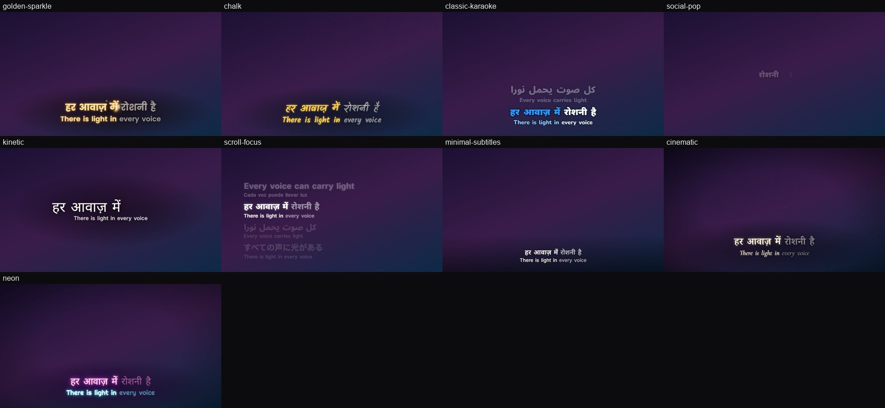

# Styles

A style is built from independent parts, and every part can be changed in `project.json`.
A **preset** is a named set of choices; your project picks one and overrides any field next to it:

```jsonc
"style": {
  "preset": "golden-sparkle",
  "text": { "primary": { "fontSize": 88, "sungColor": "#ffd27a" } },
  "layout": { "position": "top" },
  "effects": { "sparkles": { "enabled": false } }
}
```

Your editor autocompletes every field from `schema/project.schema.json` (run `npm run schema`
once if the file is missing). `npm run presets` lists the presets. Sizes are in pixels for a
1080-pixel frame and scale automatically for 4K, vertical or square output.



## Presets

| Preset | Look |
| --- | --- |
| `golden-sparkle` | Warm gold karaoke fill with a spinning star at the wipe head and sparkles shed from each sung word; lines rise out of a soft blur over a dark halo in the lower third. |
| `chalk` | Hand-written chalk lettering with a warm yellow fill over a cool halo, plus film grain. |
| `classic-karaoke` | Two alternating rows; the next line waits in the other row while the current one fills white to blue. Bold outlined type. |
| `social-pop` | Two or three big uppercase words at a time with a yellow box jumping to the sung word. Made for vertical and square video. |
| `kinetic` | Huge centred type; each word lands the moment it is sung, with a beat pulse. |
| `scroll-focus` | The whole lyric sheet scrolls; the sung line is bright and the rest fades back. |
| `minimal-subtitles` | Quiet subtitles on a thin dark band, with a gentle brightening on the sung word. |
| `cinematic` | Serif lettering that blooms in slowly with a glowing fill, a vignette, grain and drifting motes. |
| `neon` | Words switch on with a pink neon glow over a purple haze. |

## The parts

### `layout`

| Field | Values | Default |
| --- | --- | --- |
| `type` | `stack` (screen of lines), `alternate` (two-row karaoke), `pop` (a few words at a time), `kinetic` (words land as sung), `scroll` (scrolling sheet) | `stack` |
| `position` | `bottom`, `center`, `top` | `bottom` |
| `avoidFaces` | move a screen to the other end of the frame when it would cover a detected face | `true` |
| `align` | `center`, `start`, `end` (start = left for left-to-right scripts) | `center` |
| `marginX`, `marginY` | safe margins as fractions of the frame | `0.06`, `0.09` |
| `maxWidth` | fraction of the width a line may use before wrapping | `0.86` |
| `lineGap`, `wordSpacing` | spacing in em | `0.1`, `0.07` |
| `wordsPerPage`, `maxCharsPerPage` | `pop` layout limits | `3`, `22` |
| `scrollVisibleLines`, `inactiveOpacity` | `scroll` layout | `7`, `0.35` |

### `text.primary`, `text.secondary`, `tracks`

`primary` is the main sung language of each screen; `secondary` is a second sung language on
the same screen and all translations. Override a single language with `tracks`:
`"tracks": { "en": { "fontSize": 60 } }`.

Fields: `fontFamily` (any Google Font name, or a `localFonts` family; `null` = the Noto font
for each script), `fontWeight`, `fontSize`, `letterSpacing` (em), `lineHeight`,
`textTransform`, `italic`, `color` (not yet sung), `sungColor`, `shadow`, `sungShadow`
(CSS text-shadow; use it for glows), `strokeWidth`, `strokeColor`.

`fonts` sets a font per script, e.g. `"fonts": { "Deva": "Kalam", "Arab": "Cairo" }`.
`fontFallback` is `sans` or `serif` and picks Noto Sans or Noto Serif for scripts the main font
does not cover.

### `timing`

`lead` (seconds a screen appears before its first word, default 0.55), `tail` (how long it
lingers, 1.1), `holdLast` (keep the last screen until the end), `minEnter`. Screens never
overlap: when lines follow closely, the old screen leaves just as the next is needed.

### `enter` and `exit`

`enter.type`: `fade`, `blur-rise`, `rise`, `slide`, `scale`, `pop`, `mask`, `typewriter`,
`letters`, `none`. `exit.type`: `fade`, `blur-rise`, `drift-up`, `sink`, `slide`, `scale`, `mask`,
`none`. Both take `duration`, `distance`, `blur` and `ease` (`out`, `inOut`, `spring`, `linear`);
`enter` also takes `stagger` (between lines) and `wordStagger` (between words). `typewriter` and
`letters` animate letter by letter only for scripts where that is safe; joined scripts
(Arabic, Devanagari...) animate whole words.

### `highlight`

| Field | Meaning |
| --- | --- |
| `type` | `wipe` (karaoke fill across the word), `color` (word changes colour when sung), `none` |
| `softEdge` | feathered wipe edge, fraction of the word (0 = crisp) |
| `wipeEase`, `wipeLead`, `minWordDuration` | wipe feel and timing |
| `persist` | sung words stay highlighted |
| `liftY`, `liftScale`, `liftIn`, `liftOut` | the sung word rises and grows slightly |
| `dimUpcoming`, `dimFinished` | opacity of lines waiting to be sung / already sung |
| `underline` | `{ enabled, color, thickness, offset }`, grows with the wipe |
| `box` | `{ enabled, color, textColor, radius, padX, padY }`, a pill behind the sung word |
| `translation` | `line` (translations fill along with their line) or `none` |

### `effects`

| Effect | Fields |
| --- | --- |
| `scrim` | backing for legibility: `type` `radial`/`linear`/`box`/`none`, `color`, `width`, `height` |
| `glint` | star flare riding the wipe head: `enabled`, `size`, `color`, `core`, `halo`, `haloOuter`, `spin` |
| `sparkles` | stars and dust shed by sung words: `enabled`, `perWord`, `perChar`, `size`, `dustRatio`, `colors`, `core`, `glow`, `glowOuter`, `rise`, `life` |
| `particles` | drifting motes over the whole frame: `enabled`, `count`, `color`, `size`, `speed` |
| `grain` | film grain: `enabled`, `opacity` |
| `vignette` | darkened edges: `enabled`, `strength` |
| `beatPulse` | screens pulse on each detected beat: `enabled`, `amount` |

All motion is a pure function of time and all randomness is seeded, so every render of a
project is identical.

## Background

```jsonc
"background": { "type": "video", "dim": 0.2 }          // the source video, darkened 20%
"background": { "type": "image", "src": "media/cover.jpg" }
"background": { "type": "gradient", "colors": ["#1b1033", "#0e2a47"] }
"background": { "type": "color", "color": "#101014" }
```

## Make your own preset

Add an entry to `src/style/presets.ts` listing only what differs from the defaults in
`src/schema/style.ts`, add a row to the table above, and run `npm test`.
